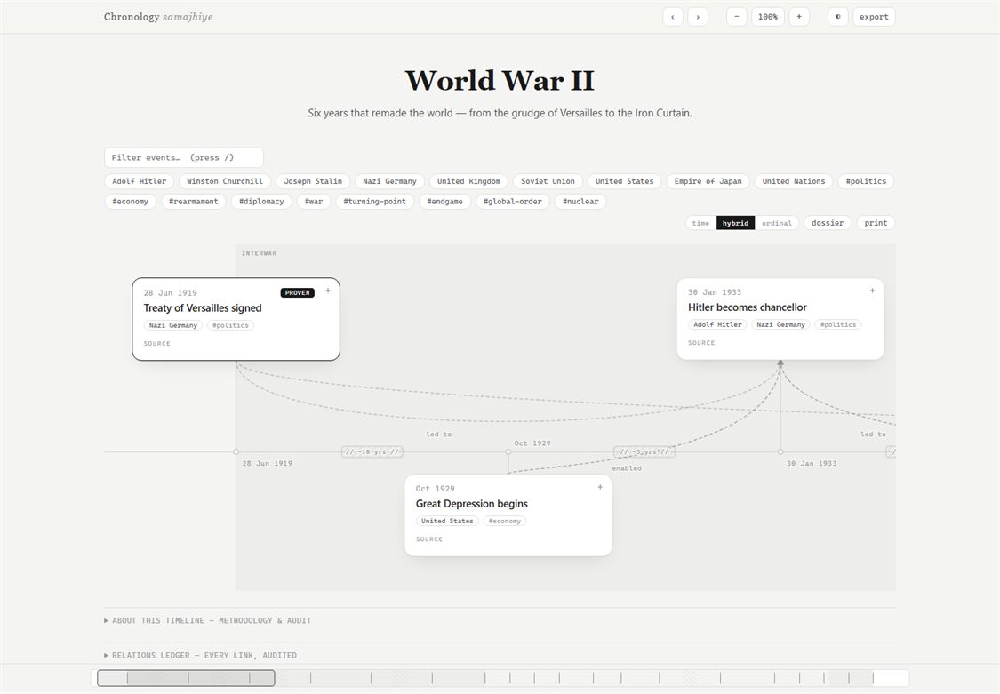

# Chronology Samajhiye

> *Chronology samajhiye* — turn messy text into a rendered causal timeline.

An Agent Skill that turns any body of events — notes, articles, incident reports, transcripts, life stories — into an **interactive causal timeline**: a chronological spine of event cards connected by labeled causal arrows ("what led to what"), delivered as a single self-contained HTML file.

- No API keys, no backend, no dependencies. **The agent itself is the LLM.**
- Output is one HTML file that works offline — open it anywhere, forever.
- Greyscale, editorial design. Hover any event to light up its direct causal links. Light/dark theme built in.
- Three time scales — **time** (proportional to elapsed time, with a minimum card clearance), **hybrid** (compresses long silences), **ordinal** (equal columns) — with real 25–500% zoom and density-aware cards.
- A minimap, `#event-id` deep links, causal-chain stepping, a stacked dossier, print/PDF, and JSON / CSV / Mermaid / TimelineJS exports.

## See it

<picture>
  <source media="(prefers-color-scheme: dark)" srcset="assets/ww2-preview-dark.png">
  
</picture>

The World War II timeline above is a **[live demo](https://raunak51299.github.io/chronology-samajhiye/examples/ww2-timeline.html)** — switch time scale, zoom out to the overview, drag the minimap, hover a card to trace its causal links, click to expand sources and counter-claims, press `/` to filter, `[` / `]` to walk a chain.

The template itself ships with the Fall of the Roman Republic as a built-in demo — open `skills/chronology-samajhiye/template.html` in a browser.

## Features

- **Real scale, not a stretched screenshot.** The layout engine reflows at every zoom level: cards step down from 300px to 210px to 132px, text stays legible, and adjacent events never collide. Long silences become labelled `// … //` breaks in hybrid mode (labels step out at overview zoom), or keep their true width in time mode.
- **Named eras.** Optional `eras[]` paint full-height period bands with small top labels in time scales, and appear as bands in the minimap.
- **A reader.** Search and tag filters, `#event-id` deep links, `[` / `]` to step along a causal chain, hover isolation, and a fixed minimap for long spines. Keyboard: `/`, `[` / `]`, `Esc`; `←` / `→` pan when the timeline or a card has focus; the minimap supports `Home` / `End`.
- **A document.** Click a card for sources, excerpts, counter-claims, and relations (from the overview, the first click zooms in); `dossier` stacks the whole record into one column; `print` produces a clean paper/PDF version.
- **Portable data.** The header menu exports stripped JSON, Excel-ready CSV (UTF-8 BOM, CRLF), a Mermaid flowchart, and TimelineJS 3 JSON.

## Install

**OpenCode (project)** — copy the skill folder (the one containing `SKILL.md`) to:

    your-project/.opencode/skills/chronology-samajhiye/

**OpenCode (global)** — same folder copied to `~/.config/opencode/skills/chronology-samajhiye/`.

**Claude Code / other SKILL.md-compatible agents** — copy to `~/.claude/skills/chronology-samajhiye/` (or `.agents/skills/`).

**HTTP catalog** — add to `opencode.json(c)`:

```jsonc
{ "skills": ["https://raunak51299.github.io/chronology-samajhiye/"] }
```

The repo root doubles as the catalog: `index.json` plus the `skills/` tree it points to. The skill's folder name is what OpenCode derives its ID from, so keep it kebab-case and unique (`skills/chronology-samajhiye/SKILL.md` reads as ID `chronology-samajhiye`). Bump `version` (semver) in `index.json` whenever skill files change so clients refresh their cache.

## Use

In any session where the skill is installed, just ask:

> "Make a timeline of everything that happened in this incident report: [paste]"
>
> "Chronology of the James Webb Space Telescope, from proposal to first images."

The agent extracts events, dates, and causal links, then writes `<output-dir>/<slug>.html` and offers to open it. Ask for changes in plain language afterwards ("drop event 3", "that arrow is wrong") — the agent edits the data block and regenerates.

## Layout

    index.json                 HTTP catalog manifest
    scripts/                   validate.mjs (timeline checker), check-catalog.mjs
    assets/                    README preview images (light + dark)
    examples/ww2-timeline.html World War II live demo (GitHub Pages)
    CHANGELOG.md               release notes
    LICENSE                    MIT
    skills/chronology-samajhiye/   the skill (folder name = skill ID)
      SKILL.md                 workflow + JSON schema + viewer controls
      template.html            self-contained renderer (greyscale, dark mode, causal arrows)
      references/
        date-rules.md          precision ladder, relative-date anchoring, ordering
        causality.md           link vocabulary, confidence rubric, anti-patterns

## Development

    node scripts/validate.mjs skills/chronology-samajhiye/template.html   # validate a timeline (.json or .html)
    node scripts/check-catalog.mjs                                         # index.json covers every skill file

CI runs both, and on pull requests fails if `skills/` changed without bumping `version` in `index.json` (use semver).

## License

MIT
